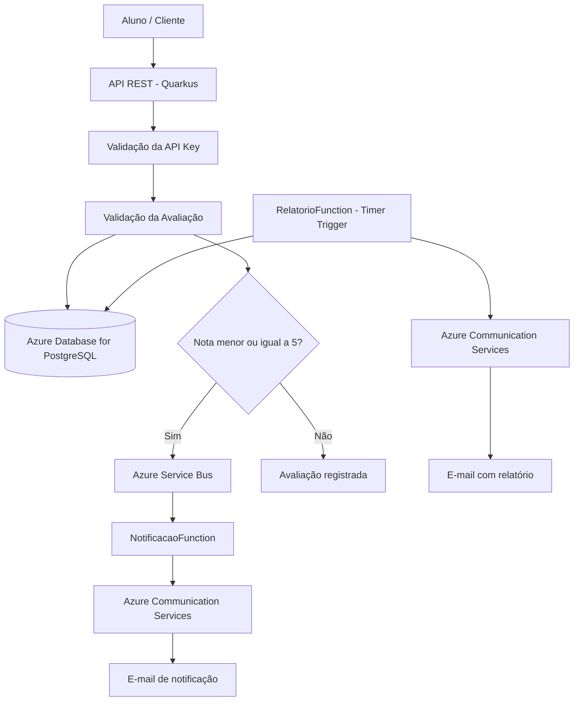

# Tech Challenge – Plataforma de Avaliação de Aulas

Plataforma serverless para registro e processamento de avaliações de aulas, desenvolvida como parte do **Tech Challenge – Fase 4 da FIAP**, utilizando Java, Quarkus, Microsoft Azure e serviços em nuvem.

O sistema permite que alunos enviem avaliações sobre as aulas. Avaliações com notas críticas são identificadas e encaminhadas para processamento de notificações. Além disso, o sistema possui processamento periódico para geração e envio de relatórios.

---

## Objetivo do projeto

Desenvolver uma solução em nuvem utilizando arquitetura serverless, com responsabilidades separadas entre os componentes da aplicação, comunicação assíncrona e integração com serviços gerenciados da Microsoft Azure.

### Funcionalidades

- Recebimento de avaliações de aulas por meio de API REST.
- Validação de chave de API para acesso ao endpoint.
- Validação das notas informadas pelos alunos.
- Persistência das avaliações em banco de dados PostgreSQL.
- Identificação de avaliações críticas (nota menor ou igual a 5).
- Publicação de mensagens para processamento assíncrono por meio do Azure Service Bus.
- Envio de notificações por e-mail para avaliações críticas.
- Geração e envio periódico de relatórios de avaliações.

---

## Arquitetura da solução

A aplicação foi organizada em componentes com responsabilidades específicas, buscando reduzir o acoplamento e facilitar a manutenção e evolução do sistema.



### Componentes

| Componente | Responsabilidade |
|---|---|
| `avaliacao-function` | Receber, validar e registrar avaliações, identificando situações críticas. |
| `processamento-function` | Processar notificações e executar a geração periódica de relatórios. |
| Azure Database for PostgreSQL | Armazenar os dados das avaliações. |
| Azure Service Bus | Realizar a comunicação assíncrona entre os componentes. |
| Azure Communication Services | Realizar o envio de e-mails. |
| Azure Application Insights | Apoiar o monitoramento e a análise de execução da aplicação. |

### Processamento de avaliações críticas

Quando uma avaliação recebe nota menor ou igual a 5, o sistema identifica a avaliação como crítica e publica uma mensagem no Azure Service Bus.

A `NotificacaoFunction` consome essa mensagem e realiza o processamento necessário para o envio da notificação por e-mail do administrador.

### Relatórios periódicos

A `RelatorioFunction` utiliza um agendamento baseado em Timer Trigger para executar periodicamente a consulta das avaliações registradas nos últimos sete dias e encaminhar o relatório por e-mail.

---

## Tecnologias utilizadas

- **Java 17**
- **Quarkus**
- **Maven**
- **Microsoft Azure**
- **Azure Functions**
- **Azure Database for PostgreSQL**
- **Azure Service Bus** 
- **Azure Communication Services**
- **Azure Application Insights**
- **Docker**
- **Docker Compose**
- **GitHub Actions**
- **Postman**

---

## Estrutura do projeto

```text
tech-challenge-fase4/
│
├── avaliacao-function/
│   ├── src/
│   ├── pom.xml
│   ├── mvnw
│   └── ...
│
├── processamento-function/
│   ├── src/
│   ├── pom.xml
│   └── ...
│
├── .github/
│   └── workflows/
│       └── deploy.yml
│       └── deploy-processamento.yml
│
├── docker-compose.yml
│
└── README.md
```

**Descrição dos diretórios:**

- `avaliacao-function`: módulo responsável pelo recebimento e registro das avaliações.
- `processamento-function`: módulo responsável pelo processamento das notificações e relatórios.
- `.github/workflows`: configurações de automação do pipeline de integração e implantação.
- `docker-compose.yml`: configuração dos serviços utilizados no ambiente local.

---
### Comportamento esperado

- A requisição deve apresentar uma chave de API válida.
- A nota deve respeitar a faixa permitida de 0 a 10.
- A avaliação deve ser persistida no banco de dados.
- Quando a nota for menor ou igual a 5, deve ser gerada uma mensagem para processamento da notificação.
- Quando a nota for superior a 5, a avaliação é registrada sem acionar o fluxo de notificação crítica.

---

## Segurança

A API utiliza autenticação por chave de acesso, recebida por meio do header:

```http
X-API-Key
```

O mecanismo de validação verifica se a chave informada corresponde à configuração da aplicação.

Requisições sem chave válida devem ser rejeitadas.

Também são adotadas boas práticas para proteção das credenciais de acesso aos serviços Azure:

- Não versionar connection strings.
- Não publicar chaves de API.
- Utilizar variáveis de ambiente.
- Utilizar GitHub Secrets para informações sensíveis no pipeline de implantação.

---

## Implantação na Microsoft Azure

A solução utiliza serviços gerenciados da Microsoft Azure para disponibilizar os recursos de processamento e armazenamento.

Os principais serviços envolvidos são:

- Azure Functions: execução das funções serverless.
- Azure Database for PostgreSQL: armazenamento persistente.
- Azure Service Bus: mensageria e processamento assíncrono.
- Azure Communication Services: envio de notificações por e-mail.
- Azure Application Insights: monitoramento e observabilidade.

O repositório também possui uma configuração de workflow do GitHub Actions para automatizar etapas do processo de implantação.

As credenciais e configurações necessárias para o deploy estão cadastradas nos secrets do GitHub, conforme as variáveis utilizadas pelo workflow.

---

## Monitoramento

O monitoramento da solução é realizado com apoio do Azure Application Insights, permitindo acompanhar informações como:

- Execuções das funções.
- Erros durante o processamento.
- Logs da aplicação.
- Falhas de integração.
- Comportamento das execuções serverless.

Essas informações auxiliam na identificação de problemas e na análise do funcionamento da aplicação em ambiente de nuvem.

---

## Considerações sobre custos

O projeto utiliza a conta Azure for Students, considerando as limitações de recursos e créditos disponíveis.

A utilização de serviços gerenciados deve observar os limites da assinatura, o consumo de recursos e as condições de cobrança de cada serviço.

É importante acompanhar os custos e configurar alertas de orçamento para evitar consumo inesperado.

---

## Contexto acadêmico

Projeto desenvolvido para o **Tech Challenge – Fase 4**, da pós-graduação em Arquitetura e Desenvolvimento Java da FIAP.

A proposta contempla a aplicação de conceitos de:

- Computação em nuvem.
- Arquitetura serverless.
- Microsserviços e separação de responsabilidades.
- Comunicação assíncrona.
- Persistência de dados.
- Integração entre serviços.
- Automação de implantação.
- Monitoramento de aplicações.

---

## Licença

Projeto desenvolvido para fins acadêmicos no contexto do Tech Challenge da FIAP.